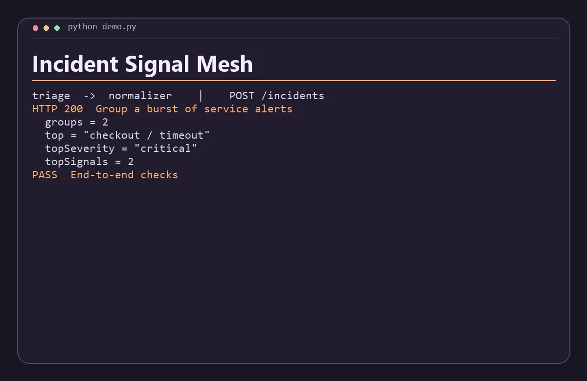

# Incident Signal Mesh

Group noisy deployment and health alerts by service and fingerprint, then rank the active incidents.



## Run the demo

Install Python 3.11+, Node.js 22+, then run this from the repository root.

```sh
python demo.py
```

The command starts both services on separate loopback ports, sends the requests in `examples.json`, checks the responses, and shuts down the processes. Use `python3` if that is how your system exposes Python.

## Run the services with Docker Compose

```sh
docker compose up -d --build
python demo.py --base-url http://127.0.0.1:8080
docker compose down
```

The API binds to loopback on port 8080 by default. Set `DEMO_PORT` and use the matching base URL to run another project alongside it. Set-up and service discovery follow the [Docker Compose networking documentation](https://docs.docker.com/compose/how-tos/networking/).

Both services are stateless and work with the data in each request. Start from fresh demo state before rerunning the scripted Compose checks.

## Architecture

Normalizer maps source severities to a shared scale and canonicalizes labels. Triage groups normalized signals, suppresses duplicate event IDs and ranks groups by severity and recurrence.

| Service | Runtime | Operation |
| --- | --- | --- |
| `triage` | Python | Public demo API, `POST /incidents` |
| `normalizer` | JavaScript | Internal service, `POST /normalize` |

The two services exchange JSON over HTTP. Each has a `GET /health` endpoint for process readiness. A gateway request returns HTTP 502 when its dependency is unavailable or fails unexpectedly. Invalid input returns HTTP 400. Domain conflicts return HTTP 409 where supported.

## API example

Send signals with id, service, fingerprint and severity (info, warning, error or critical). Event IDs must be unique across sources. The endpoint summarizes the supplied batch.

From a running Compose stack, save this JSON as `input.json` and run the command below. On Windows use `curl.exe` if your shell aliases `curl`.

```json
{
  "signals": [
    {
      "id": "a",
      "service": " CHECKOUT ",
      "fingerprint": "timeout",
      "severity": "warning"
    },
    {
      "id": "b",
      "service": "checkout",
      "fingerprint": "timeout",
      "severity": "critical"
    },
    {
      "id": "b",
      "service": "checkout",
      "fingerprint": "timeout",
      "severity": "critical"
    },
    {
      "id": "c",
      "service": "catalog",
      "fingerprint": "lag",
      "severity": "error"
    }
  ]
}
```

```sh
curl -s -H "Content-Type: application/json" --data-binary @input.json http://127.0.0.1:8080/incidents
```

The response includes these fields.

```json
{
  "groups": 2,
  "top": "checkout / timeout",
  "topSeverity": "critical",
  "topSignals": 2
}
```

## Scope

This is a local portfolio project using synthetic data. The APIs are intended for loopback and the private Compose network. A public deployment would need authentication, rate limits, and production observability.
